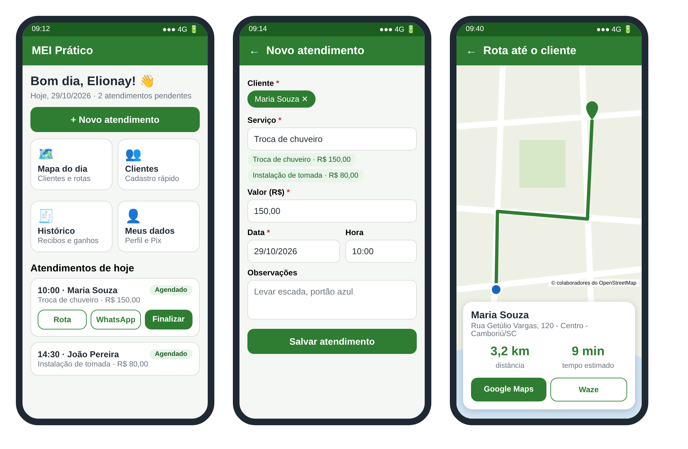
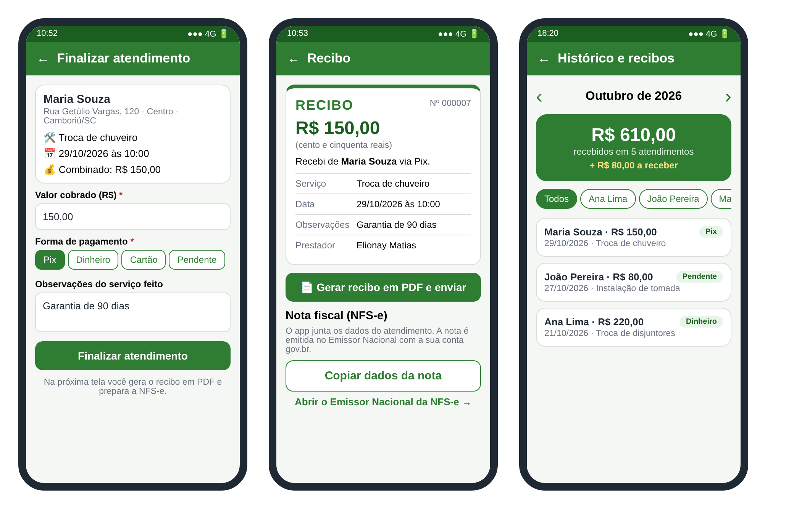

# MEI Prático

App de celular para o MEI que atende na casa do cliente: agenda, mapa com rota, recibo em PDF e dados prontos para a nota fiscal.

Projeto de Extensão Universitária II – Sistemas de Informação, IFC Camboriú (2026.2).
Aluno: Elionay Matias.

## Telas

**Início, novo atendimento e rota até o cliente**



**Finalizar, recibo e histórico do mês**



## Como rodar

Precisa de:

- [Node.js](https://nodejs.org) (versão LTS)
- App **Expo Go** no celular, versão **SDK 54**

```
git clone https://github.com/NayMatias/Mei-Pratico.git
cd Mei-Pratico
npm install
npx expo start
```

Leia o QR Code com o Expo Go. PC e celular no mesmo Wi-Fi.
Se não conectar, use `npx expo start --tunnel`.

Para rodar os testes: `npm test`

## Feito com

React Native + Expo · SQLite · OpenStreetMap · OSRM · ViaCEP

## Documentos

- [Relatório Final (Checkpoint 4)](docs/EX2_CheckPoint-4_ElionayMatias.pdf)
- [Outros relatórios e diagramas](docs/)
- [Histórico de versões](CHANGELOG.md)
